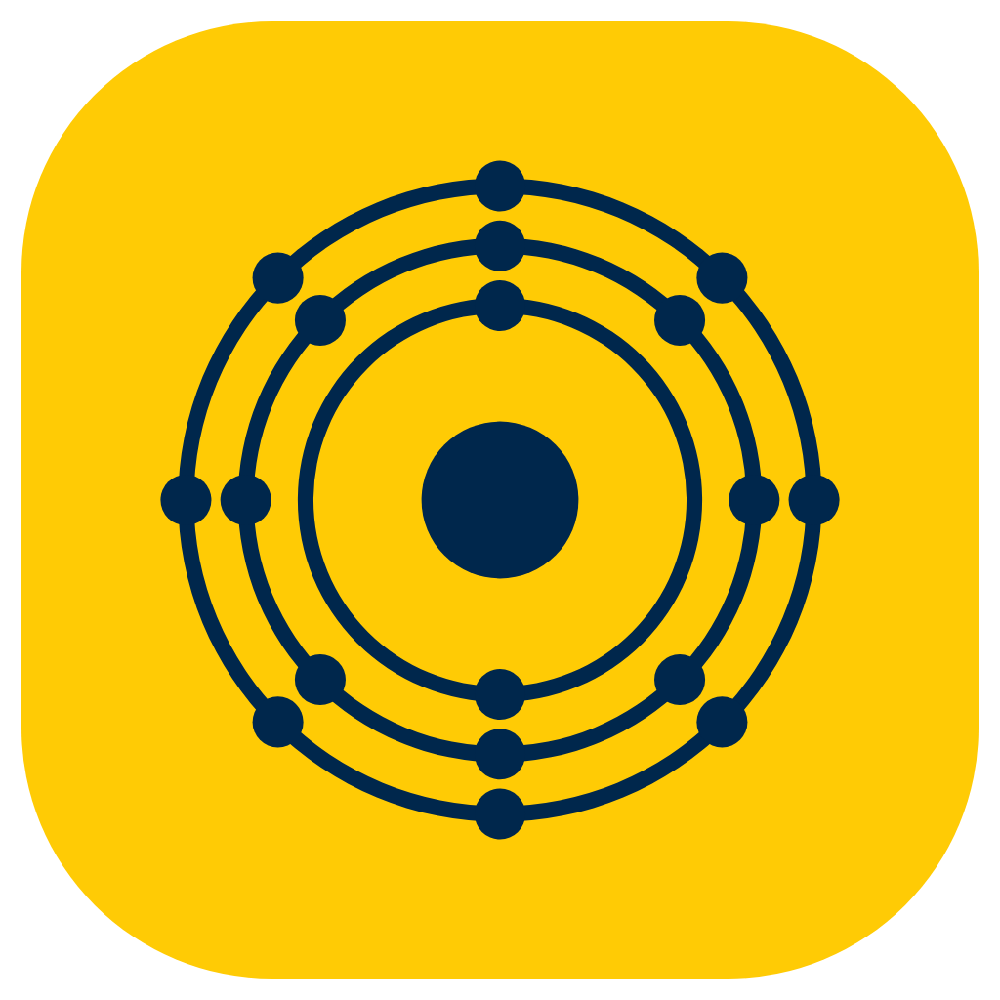

    
    <h1>Argon</h1>
    

        A personal fork of the Helium browser, renamed Argon.
    

## About
Argon is [Helium](https://github.com/imputnet/helium) with its own name,
icon and app identity. The logo is argon's atom: 18 electrons in shells of
2, 8 and 8, in Michigan maize and blue. Everything else, including the
privacy and comfort features, comes from Helium.

What differs from Helium:

- The name is Argon everywhere the browser shows it, and internal pages
  open as `argon://` (`chrome://` still works).
- Argon has its own identity on every platform: macOS bundle ID
  `io.github.anyosag.argon`, its own profile folder, Keychain item, and
  Windows install folder, registry keys and file associations. It installs
  next to Helium without sharing data with it.
- Argon still uses Helium services (extension downloads, !bangs, filter
  list updates, spell check dictionaries). Settings keep calling them
  "Helium services" because they run on Helium's servers. You can point
  Argon at your own instance of them in settings.

## Repos
- [Argon](https://github.com/anyosag/Argon) (this repo): the patches,
  branding and tools shared by every platform.
- [argon-macos](https://github.com/anyosag/argon-macos): macOS packaging.
- [argon-windows](https://github.com/anyosag/argon-windows): Windows
  packaging.

Both platform repos include this repo as their `helium-chromium` submodule.

## Building
See the platform repos. Their build docs come from Helium and apply
unchanged: [macOS](https://github.com/anyosag/argon-macos/blob/main/docs/building.md),
[Windows](https://github.com/anyosag/argon-windows#readme).

## Credits

### Helium
Argon is built on [Helium](https://github.com/imputnet/helium) and its
packaging repos for [macOS](https://github.com/imputnet/helium-macos) and
[Windows](https://github.com/imputnet/helium-windows). Helium's services,
onboarding, uBlock Origin fork and Chromium source tarballs are used as they
are published by Helium.

### The Chromium project
[The Chromium Project](https://www.chromium.org/) is at the core of Helium,
and so of Argon.

### ungoogled-chromium
Helium originally branched off
[ungoogled-chromium](https://github.com/ungoogled-software/ungoogled-chromium).

### Other Chromium projects
Helium includes some patches from other open source Chromium projects:

- [Inox patchset](https://github.com/gcarq/inox-patchset)
- [Debian](https://tracker.debian.org/pkg/chromium-browser)
- [Bromite](https://github.com/bromite/bromite)
- [Iridium Browser](https://iridiumbrowser.de/)
- [Brave](https://github.com/brave/brave-core)

All patches are sorted by vendor in the [patches](patches/) directory of this repo.

## License
Argon, like Helium, is licensed under GPL-3.0. See [LICENSE](LICENSE).

Any content imported from other projects retains its original license (for
example, any original unmodified code imported from ungoogled-chromium remains
licensed under their [BSD 3-Clause license](LICENSE.ungoogled_chromium)).
